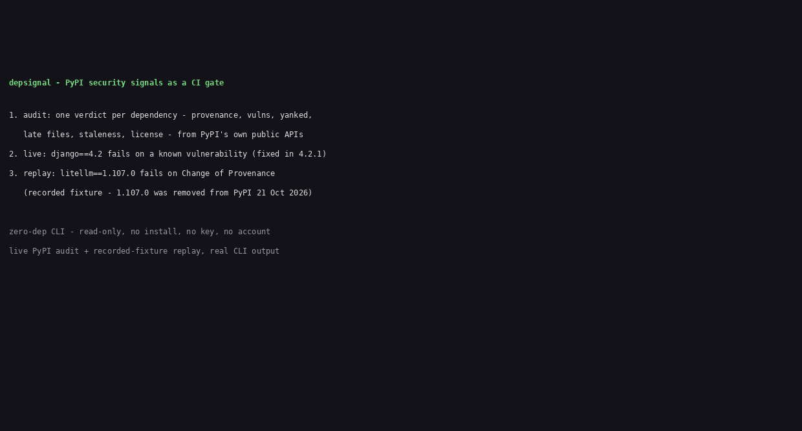

# depsignal

**Audit a Python project's dependencies against PyPI's own published security signals - and get one CI verdict per dependency.**

`depsignal` reads what PyPI itself publishes for every release - build provenance/attestations, known vulnerabilities, yanked status, late-file warnings, release age and license metadata - and turns it into a gate: PASS, WARN or FAIL. No install, no virtualenv, no key, no account. Zero runtime dependencies. TypeScript, Node 20+.

## Why this exists

On 6 November 2026 PyPI redesigned every project page with a **Security tab**: each release's provenance state and per-file attestations (published via Trusted Publisher, SLSA Build Provenance), plus four provenance warnings - Incomplete, Inconsistent, Change (different repo/workflow than the last release) and Loss (stopped publishing attestations). Late-file warnings flag files uploaded more than 14 days after the release (pre-July-2026 releases only; PyPI has rejected late files since July 2026). The signals exist. Nobody reads 40 project pages by hand before `pip install`, and there is no machine-readable gate for them in CI. That is the gap.

The failure mode is fresh and real. **LiteLLM 1.107.0, 21 October 2026:** the project's own release pipeline was compromised (stolen GitHub CLI OAuth tokens); attacker-built wheels from a lookalike repo (Berri-AI/litellm vs the real BerriAI/litellm) were published to PyPI - seven wheels, live 11:39-13:23 UTC (about 1h44m), carrying a credential stealer (`cook.pth` / `cook.py` / `sitecustomize.py`, runs on every Python start) plus an hourly remote-code loader. PyPI removed/quarantined 1.107.0; the clean pin is 1.106.2. It was the second LiteLLM compromise of 2026 (March: 1.82.7/1.82.8). The sharpest detail: the malicious wheels were built by the official pipeline, and **build provenance recorded the malicious fork as the source** - provenance alone does not mean safe. A **Change of Provenance** vs the previous release is exactly the detectable signal, and it is the one `depsignal` fails on.

## 1. How it compares (checked 15 November 2026)

| Tool | Form | What it does well | What it cannot do (depsignal's wedge) |
|---|---|---|---|
| **pip-audit** (PyPA) | Python CLI | Vulnerabilities via OSV for an installed env or requirements file | Vulns only. No provenance/attestation, no yanked, no staleness, no late-file. Needs an environment or a resolvable requirements file. |
| **safety** (Safety CLI) | Python CLI | Vulns + license from a commercial DB | Vulns + license only; no registry provenance signals; commercial DB terms. |
| **osv-scanner** (Google) | CLI | Vulns across ecosystems from OSV | Vulns only; no PyPI-specific signals (provenance/yanked/late-file). |
| **vetgate** (own factory, #6) | CLI | Pre-execution gate for ONE artifact: downloads the published tarball, inspects contents | Different moment and signals: single artifact before install, content scan. depsignal audits the WHOLE dependency list from registry-published signals and downloads nothing. |
| **extverify** (own factory, #15) | CLI | Verify-before-install for agent extensions (publisher identity + marketplace trust) | Different surface: extensions, not PyPI dependencies. |
| PyPI Security tab itself | Web page | Shows the signals, one project at a time | Not machine-readable as a gate; no CI, no baseline, no diff. depsignal is the CLI that reads the same signals. |

**Where rivals beat us (read this before trusting depsignal alone):** pip-audit and osv-scanner cover more ecosystems and match vulnerabilities more deeply, including transitive dependencies via lockfiles; safety has a curated database with remediation guidance. depsignal v0.1.0 is PyPI-only, direct dependencies only (no transitive resolution), and cannot see archived/quarantined status if PyPI does not expose it in the APIs it reads (see Honest limits). depsignal is the **registry-signal layer** - provenance, yanked, late-file - and complements, not replaces, a vulnerability scanner.

## 2. Quickstart (install from source)

The `depsignal-cli` package is not published to npm yet. Install from source:

```sh
git clone https://github.com/techdevfun/depsignal.git
cd depsignal
npm install
npm run build
node dist/cli.js --help
```

Or link the binary locally:

```sh
npm link
depsignal --help
```

The npm package name is `depsignal-cli` (npm `depsignal` is taken) and the binary is `depsignal`.

## 3. Demo



Real CLI output. Part 1 is a live audit against PyPI (no auth): `django==4.2` fails on a known vulnerability fixed in 4.2.1, `pillow` and `requests` resolve to their latest releases and pass. Part 2 replays `litellm==1.107.0` against a local fixture server with recorded payloads - 1.107.0 no longer exists on PyPI, so a live probe cannot reproduce it - and fails on Change of Provenance. The replay is labelled as a recorded fixture in the transcript and in the fixture files. Full transcript: [demo/transcript.txt](demo/transcript.txt).

```sh
depsignal audit examples/demo-requirements.txt
depsignal audit examples/litellm-replay-requirements.txt --pypi-base http://127.0.0.1:PORT
```

## 4. Commands

```sh
depsignal audit <requirements.txt | pyproject.toml> [--json]
          [--allow <pkg> ...] [--save-baseline <file>] [--pypi-base <url>]
          [--limit <n>]
depsignal check --baseline <file> [--input <req>] [--pypi-base <url>]
depsignal diff <baseline-a> <baseline-b>
depsignal explain <pkg>[@<version>] [--pypi-base <url>]
```

- `audit`: one verdict per dependency. Exit 0 = no FAIL, 1 = at least one FAIL, 2 = usage or network error. `requirements.txt`: `name==version` is audited exactly; ranges and unpinned names resolve to the latest stable release and are LABELLED as such in the output. `pyproject.toml`: `dependencies` (PEP 508 name + specifier; extras and markers parsed, environment markers honoured by skipping non-matching entries and saying so). `--allow <pkg>` downgrades that package's FAIL findings to WARN (reported, not hidden). `--save-baseline` writes the audit as a baseline file. `--limit <n>` shows at most n findings per package in human output (the table header still shows the full count, and `--json` always lists every finding).
- `check`: FAIL only on NEW failings vs a saved baseline (the CI gate for existing projects). Fixed findings are listed, not failed.
- `diff`: fixed / new / unchanged findings between two baselines.
- `explain`: drill-down for one package: every signal with its source URL (PyPI JSON + Simple API links, plus the Security tab link).
- `--pypi-base <url>` points the client at another registry-compatible server. It exists so the LiteLLM 1.107.0 replay can run against a local fixture server with recorded payloads; the default is `https://pypi.org`.

## 5. Verdict rules

All signals come from public PyPI APIs (10 s timeout, at most 1 retry). Sources verified live 15 November 2026.

| # | Signal | Source | Rule |
|---|---|---|---|
| S1 | Known vulnerability | JSON API top-level `vulnerabilities` (OSV: id, aliases, `fixed_in`, link, withdrawn) | FAIL if an unwithdrawn vuln affects the pinned version (pinned below the `fixed_in` of its own release line, or no `fixed_in` at all). Reports id + aliases + fixed version + osv.dev link. Duplicate GHSA/PYSEC entries for the same advisory are collapsed. |
| S2 | Provenance | Simple API v1.4 `provenance` per file | Full (every file attested) / Partial / None. None = WARN (origin unverifiable, not a malware flag - the output says so). Partial = WARN. Change of coverage state vs the previous stable release = FAIL (the LiteLLM signal). |
| S3 | Yanked | JSON API `info.yanked` + per-file `yanked` | Pinned version yanked = FAIL. Latest release yanked = WARN. |
| S4 | Late file | Simple API `upload-time` per file | File uploaded more than 14 days after the release's first file (pre-July-2026 releases only) = WARN. |
| S5 | Staleness | Simple API upload times of the latest stable release | Latest stable release more than 2 years old = WARN, with the honest note that stability is not abandonment. `--allow` suppresses per package. |
| S6 | License | JSON API `info.license` / `license_expression` | No license metadata = WARN. |
| S7 | Archived / quarantined | Simple API `project-status` | See Honest limits: not claimed as detected. |

### What the provenance field actually is

Verified live 15 November 2026 (requests 2.34.2, pillow 13.0.0, litellm 1.106.2, django 4.2): Simple API v1.4 file entries carry `provenance` as a **URL string or null** - e.g. `https://pypi.org/integrity/requests/2.34.2/requests-2.34.2-py3-none-any.whl/provenance` - pointing at Sigstore attestation bundles. The API exposes **no repository identity**: the publisher identity lives inside the Sigstore certificate, which this CLI does not decode. So change detection compares attestation PRESENCE between releases (attested vs unattested), and the finding says so. A change in either direction fails: attestations appearing from a new publisher is the LiteLLM signal, and attestations disappearing is a loss. This also flags a project adopting attestations for the first time; use `--allow` for that case.

Verified the same day: django 4.2 carries GHSA-r3xc-prgr-mg9p / CVE-2023-31047, fixed in 4.2.1; requests 2.34.2 and pillow 13.0.0 are fully attested with no vulnerabilities in the JSON API; litellm 1.106.2 carries no provenance on any of its 8 files; litellm 1.107.0 returns 404 on PyPI.

## 6. CI flow

```yaml
- run: npm ci
- run: npm run build
- run: depsignal audit requirements.txt --save-baseline baseline.json
```

For an existing project, commit the baseline and gate on new failures only:

```sh
depsignal check --baseline baseline.json --input requirements.txt
```

Exit 1 only when a NEW failing appears. `depsignal diff baseline-old.json baseline-new.json` shows what was fixed and what is new.

## 7. Honest limits

- **PyPI only, direct dependencies only.** No transitive resolution, no lockfiles, no other registries. A vulnerable transitive dependency is invisible to v0.1.0 - run pip-audit or osv-scanner alongside.
- **Archived / quarantined status is not claimed as detected.** We probed for it during the build: the Simple API exposes `project-status` (observed value: `"active"` on every project checked) and neither the JSON API nor the Simple API exposed an archived/quarantined flag for any project probed as of 15 November 2026. `explain` links the Security tab so a human can check. If PyPI exposes the flag in an API later, depsignal should read it.
- **Provenance change is a presence signal, not an identity proof.** depsignal cannot tell you WHICH repository published a release, only whether attestations exist and whether that changed. A legitimate publisher migration and a pipeline takeover look the same to this signal - that is why it fails loudly and why `--allow` exists.
- **Vulnerability matching uses `fixed_in` per release line**, not full OSV ranges. It is correct for the common case (django 4.2 < 4.2.1) and unit-tested on real cases, but a vuln whose `fixed_in` lists only another major line is treated as not affecting the pinned version. When in doubt, cross-check with pip-audit.
- **Staleness is a WARN, not a verdict on quality.** Old stable packages are often finished, not abandoned.
- **Unpinned dependencies resolve to latest at audit time.** The output labels the resolved version; pin for reproducible gates.

## 8. Roadmap

- Decode the Sigstore certificate behind the provenance URL to report the publishing repository and workflow (real identity change detection, fewer false FAILs on first-time attestation adoption).
- Transitive dependencies via `pip-compile` / lockfile input.
- Archived/quarantined detection the moment PyPI exposes it in an API.
- OSV range-based vulnerability matching alongside `fixed_in`.
- npm publish of `depsignal-cli` (pending owner token).

## 9. License

MIT. See [LICENSE](LICENSE).
